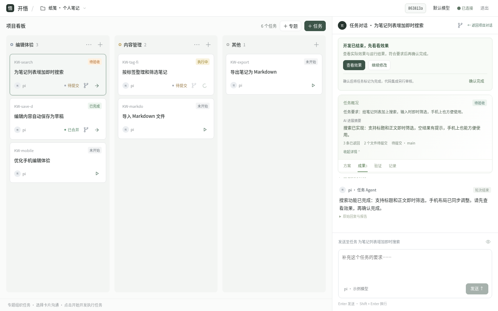
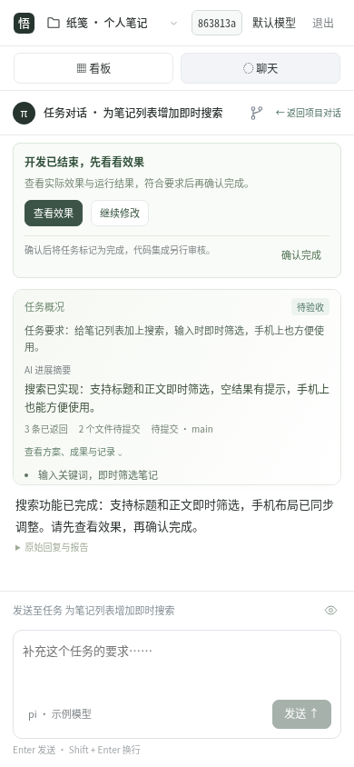

# 开悟 · kaiwu

**从想法到作品，在创造中更新认知。**

开悟是一个本地优先的个人 AI 开发工作台。用专题看板组织任务，在独立对话中与 Agent 协作，跟踪开发进展、查看实际效果，再决定是否确认和合并。

[快速开始](#快速开始) · [使用说明](apps/web/README.md) · [路线图](docs/roadmap.md) · [反馈问题](https://github.com/SatoriTours/kaiwu/issues)

## 界面预览



<details>
<summary>查看手机界面</summary>
<br>

</details>

<sub>当前 Web 界面的演示截图，使用合成项目和对话，不包含真实用户数据。</sub>

## 核心功能

- **按专题组织任务**：功能分组与执行状态独立，进展一目了然。
- **一任务一上下文**：项目与任务分别绑定独立 pi 会话，历史和草稿互不混淆。
- **隔离开发**：任务在独立 Git worktree 中执行，中断后按新的发送意图接回原会话。
- **看结果再确认**：查看进展、工具记录、错误原因及受控网页预览，不把模型回复结束当作验收通过。
- **保留你的控制权**：模型沿用服务器 pi 配置；审核后显式选择本地合并或合并并推送，不自动上传，也不把 Git 成功当作 CI／部署通过。

## 本地开发进展

聊天气泡间距与网页结果链接已本地优化：收紧用户消息上下留白，结果 URL 直接显示在回复下，并要求网页任务说明真实访问地址或受控预览入口。100项前端测试、构建、受影响Go两包及5项浏览器回归通过，独立功能与桌面／手机读图验收通过；用户已要求提交交付，实际版本以入口修订号为准，未做真实模型联调。[本批记录](docs/development/web-chat-spacing-links-verification.md)。

聊天状态轻提示已在本地实现：空闲 pi 断开静默，真正中断／失败归属对应轮次并以一行小字展示，可用原因按需查看；旧结果保留，送达未知不直接重试。15 项定向单元、默认前端测试／构建、Go 相关两包及 11 项隔离浏览器自测通过；独立功能与桌面／手机深浅色读图验收通过；用户已要求提交代码，交付版本以实际入口修订号为准。[本批记录](docs/development/web-chat-quiet-status-verification.md)。

C 冷灰聊天已在本地实现（深色已按“太黑”反馈提亮为石板灰，亮度调整13项回归及独立窄复验通过）：无框回复、紧凑输入、历史正文直读，任务完成移入卡片菜单并显式确认；保留浅色及720px覆盖式抽屉。独立单元、14项核心浏览器和聊天／菜单／对话框视觉验收通过；基线 `4f36acc` 已通过干净归档全量门禁（79项浏览器）并更新实际7331入口；后续HTTP被动状态／前台Open并发重挂载失效已补受控红绿回归，见[修正边界](docs/development/web-task-result-preview-verification.md#2026-10-29-被动状态回执与前台open并发)。随后受控夹具证实DOM更新而原生输入几何仍旧，SDK匹配156也会出现；测试现先独立原生悬停再点击，7项预览与43项业务、77单元、163路由自测通过，独立关键4项通过。不把少量成功当全部间歇已消除；用户已要求提交代码，按既有全量门禁／推送／实际入口核验交付，实际版本以入口修订号为准。[实现与验收边界](docs/development/web-cold-chat-verification.md)。

项目文件管理、Linux 命令行终端与聊天图片／文件附件已接入本地代码，自测与独立功能复验通过，独立视觉及图片预览修复复验通过；已随基线 `4f36acc` 推送并部署，后续实际版本以运行修订号为准；未做真实业务模型联调。[范围、限制与证据](docs/development/web-project-tools-verification.md)。

## 快速开始

需要 **Linux、Go 1.25+、Node.js 22.18+（含 npm）和 Git**。使用 AI 功能前，还需在服务器安装 pi、配置模型登录，并确保服务的 `PATH` 能找到它。任务所需的编译器和工具也应安装在服务器上。

```bash
git clone https://github.com/SatoriTours/kaiwu.git
cd kaiwu

npm --prefix apps/web ci
npm --prefix apps/web run build

export KAIWU_DATA_DIR="$PWD/.kaiwu"
export KAIWU_WEB_TOKEN="$(node -p 'require("node:crypto").randomBytes(32).toString("hex")')"
printf '本机访问令牌：%s\n' "$KAIWU_WEB_TOKEN"
GOTOOLCHAIN=local go -C server run ./cmd/kaiwu-server
```

打开 **http://127.0.0.1:7331**，输入上面的令牌。添加服务器项目目录、选择模型并创建任务，准备好后点击「开始开发」。端口已被占用时，先检查已有服务。

> `.kaiwu/` 保存数据库、会话等私有数据，请勿提交。远程访问请使用受信任的局域网或已有 VPN，并保留认证；Git worktree 不是系统安全沙箱。

## 开发与文档

前端使用 **Vue 3 + TypeScript + Vite**，由 **Go** 同源托管；状态保存在 **SQLite**，Go 通过 RPC 管理第三方 **pi CLI**。

```bash
npm --prefix apps/web test
GOTOOLCHAIN=local go -C server test ./...
```

- [Web 使用与配置](apps/web/README.md) · [服务端开发](server/README.md)
- [产品需求](docs/product-requirements.md) · [架构与边界](docs/architecture.md)
- [本地部署与版本核查](docs/development/local-deployment.md) · [历史开发记录](docs/development/project-history.md)

## 项目状态

聊天待处理交互 V2 已在本地实现：输入／选择／确认使用聊天内弹层，任务卡片优先显示待处理状态并可一键打开；收起保留草稿，回答后收敛为折叠记录。70 项基线单元、26 项交互／命令单元、构建及 2 项真实 Go＋fake pi 新用例自测通过；独立 8 项交互、3 项抽屉、22 项聊天回归通过，历史状态及筛选问题已修正，最终构建 2 项 V2 浏览器独立窄复验通过，功能验收通过。后续独立读图补验确认桌面及 390／360px 实现截图符合设计，原视觉阻塞已解除，本批本地限定范围验收通过。用户已要求提交代码，现按既有流水线交付，运行版本以实际入口修订号为准；未调用真实模型。[本批记录](docs/development/web-interaction-v2-verification.md)。

聊天已在本地改为右侧独立抽屉：默认收起，看板占满全宽；卡片／项目对话打开720px浮层，手机全屏，关闭不停止任务或丢草稿。57项主配置浏览器、70项单元及22项聊天回归独立通过；独立读图及浅色截图窄复验通过；用户已要求提交代码，主题与抽屉按既有流水线交付；运行版本以实际入口修订号为准。[本批验证](docs/development/web-chat-drawer-verification.md)。

Web 深色模式已在本地实现：默认跟随系统并实时切换，可手选浅色／深色，浏览器记住偏好；登录、看板、聊天、Markdown、菜单及弹窗沿用灰绿风格（其后获批的聊天抽屉布局另见上文）。7项主题浏览器、70项单元与构建自测通过，独立功能／回归／读图验收通过，首轮发现的顶栏高度回归已修复并窄复验关闭；本批已获提交代码授权，与聊天抽屉一并交付，运行版本以实际入口为准。[本批验证](docs/development/web-theme-verification.md)。

任务聊天 V5 已实现并以 `1ebcc7a` 推送 main：保留原 Kanban 与顶栏，支持左右消息、轻量结果操作、折叠历史，普通问答不替换开发结果；独立功能、22 项聊天回归及独立视觉验收通过。用户追加授权修复旧部署门禁：V5 交互断言、测试服务生命周期及真实 Git fixture 追踪已修正，47 项浏览器与150项部署脚本测试及独立复核通过。保留两项非阻塞的回归覆盖缺口，不跳过部署门禁；部署版本以实际入口为准。线上生效以实际入口完整修订号为准。[本批验证](docs/development/web-task-chat-focus-verification.md)。

登录页已按紧凑灰绿设计完成本地改版：支持令牌显示／隐藏，保留 30 天登录；10 项登录浏览器测试及独立复验通过；实际部署以入口显示的修订号为准。[本批记录](TODO.md#当前改版紧凑灰绿登录页)。

2026-10-24 的成果流程增量已在本地实现：静态网页新标签页、显式文件下载、双合并审核与每问题一条可展开回复。下载 Go 后端的 manifest 绑定修复已通过独立复验；前端 68 项单测与构建通过；登录同步及夹具容量问题修正后，正式 `cd apps/web && npm run test:chat-turn` 自动串行分片的全部 19 项 Chromium 自测通过，独立功能／质量窄复验通过，独立视觉验收仍受模型能力限制，待补授权。**用户已要求提交，收尾交付进行中；独立视觉与真实 UI 远端联调尚未完成，不将本地测试称为整体交付通过。线上生效以实际入口完整修订号为准。** [当前台账](TODO.md) · [验证范围](docs/development/web-task-result-preview-verification.md#2026-10-24-产物直达与双合并增量)。

自动交付的 C2 远程执行边界已完成一批安全修复并通过限定独立复验，含配置重验、凭据环境隔离、HTTP 传输覆盖及仓库 askpass 防护；Git／交付／凭据回归与手动调用层检查通过。I1 SSH 接线及本轮 `%` 密钥路径／最终远程 URL 收尾已独立通过，三包回归与相关 race／vet 通过。C3 实际 workflow 冻结首片已独立通过：按实际 Git 对象冻结 `.github` 定义，原 `refs/replace` 绕过已用独立机器级红绿对照关闭；定向 race／vet 通过。显式检查脚本／配置文件声明保护亦经独立验收通过，含相关 Go／Web 回归、设置保存重开及桌面／手机视觉核查；只保护已声明文件，不推断传递依赖；恢复调度屏障、push 核查与 CI 计时起点已补确定性修复；独立初验发现的多 pending push 提前放行亦已修复，相关 Go 回归／race 与独立聚焦复验通过（仅 I11 子片）；非 push 写权／意图、暂停撤销及其余 CI 门禁仍开放，worker 继续禁用；本批进入提交交付，部署状态以实际入口修订号为准。[安全裁决与范围](docs/development/web-automated-delivery-review-resolution.md)。

项目仍在开发中，当前优先打磨 **Web + pi** 的任务流程。桌面端（Windows / macOS / Linux，Nim + Leaf）与 Android（Kotlin / KMP / Compose）仍是目标，目前尚未提供原生客户端；Codex、自动多 Agent 编排和真实自动交付尚未开放。

欢迎通过 [Issues](https://github.com/SatoriTours/kaiwu/issues) 交流问题与建议。**许可证尚未确定**，公开仓库不代表已授予使用、修改或分发许可。
