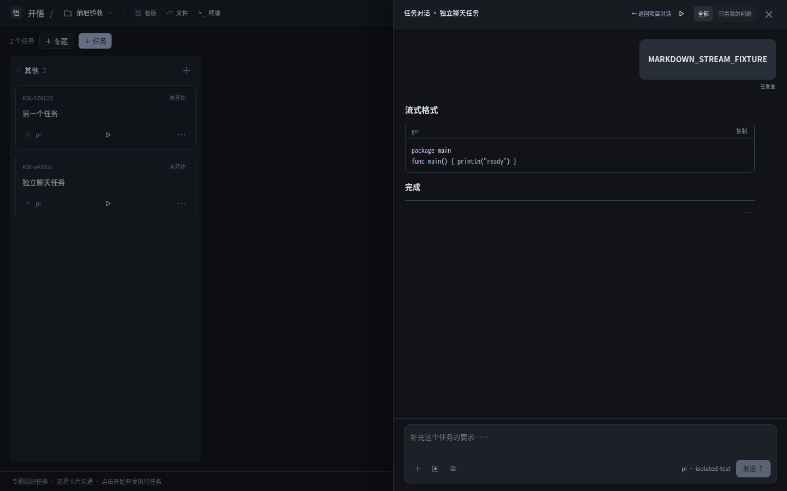
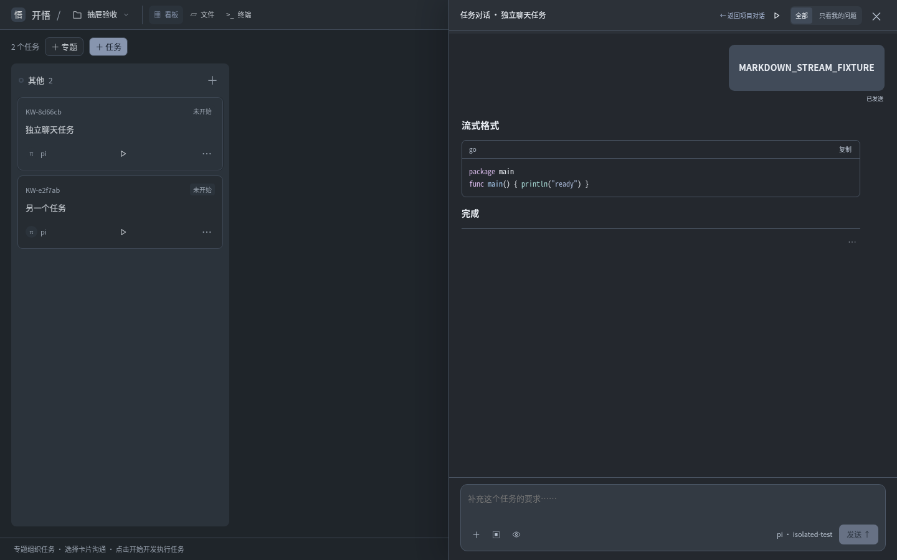

# C 冷灰聊天实现与验收（2026-10-27）

> 2026-10-29：用户已要求“提交代码”，进入本任务范围核对、提交／推送与干净归档部署流程。下文“未提交／未部署”是各轮验收快照状态，不代表后续交付结论；实际结果以本次提交SHA、部署门禁日志及7331运行版本为准。暂停的子Agent后端／迁移与前序混合成果不纳入本次。

## 授权与当前结论

用户选择 C 冷灰参考并要求开始开发。已实现，**C 冷灰聊天、卡片完成入口的独立功能与代表聊天视觉通过；HTTP 预览间歇回归仍未闭合，不称全套稳定通过**。保留既有 720px 覆盖式聊天抽屉及手机全屏，不采用原型并排布局。未提交、推送或更新 7331，未修改 Go 业务状态机、共享模型声明、认证或网络安全配置。

## 本批实现

- 冷灰深色主题；浅色、系统自动切换及偏好记忆保留。AI 正文无外框，14px／1.9 行距、最大 640px；用户右侧气泡，代码零额外字距。
- 删除头像、可见我／AI及重复 Agent 身份行、常驻发送对象／快捷键说明。保留可访问角色、投递状态、执行中／失败等真实风险；轮次与执行端移入“本轮信息”。
- 筛选并入顶栏，Markdown 预览进入输入工具栏；默认 48px，长文内部滚动，不新增自动增长。
- 历史正文直接显示，详情与历史成果按需展开，不再折叠成“上一轮结果／已验收”。执行详情箭头与文字水平对齐，AI 检查自述与真实工具依据仍分开。
- 聊天不再提供确认完成，任务卡片菜单提供可选“标记任务完成”。原 `confirm_result` 继续服务端核验，不把回复结束自动当作任务完成。
- 完成对话框冻结任务／项目／会话／轮次，并提醒缺成功执行依据的检查；离线、请求进行中、运行、交付、阻塞交互或新轮次不允许确认。取消不改状态，确认不触发测试、Git 或部署，仍能继续聊天。
- 打开聊天时保持看板列高度，列表独立滚动；关闭面板不结束会话或丢失独立草稿。

## 已有自测证据

证据根：`~/.local/state/agent-artifacts/kaiwu/2026-10-27-cold-chat-implementation/`。初始已有大量其他未提交成果，按 `baseline.json` 与 `baseline/` 核增量，未覆盖或归入本批。

| 检查 | 已知结果 |
| --- | --- |
| `cd apps/web && npm run build` | TypeScript／Vite／Go embed 复制通过，`build-4.log` |
| `cd apps/web && npm test` | 所有单元套件通过，含 3 个新增完成门禁／冻结单元，`unit.log` |
| `npx playwright test --project=drawer --project=theme --project=project-tools` | 14/14 通过，`core-4.log` |
| 键盘、筛选／定位、草稿隔离定向回归 | 1/1 通过，`chat-keyboard.log` |
| 结构化进展、完成后刷新／Git状态、历史正文业务回归 | 3 项通过，`business-2.log` |
| HTTP 任务预览 | 间歇失败未闭合，见下文，不称全通过 |
| `npm run test:chat-turn` | 首跑第 4/6 批旧导航失败；该项真实返回看板后定向通过，第 5/6 批另以新服务分别 4/4、2/2 通过。22 个发现用例均有分批成功证据，**不是一次完整 npm 入口全绿** |
| 菜单与完成对话框桌面／手机 | 新增1440／390px可见／视口边界及取消不改状态断言，单项通过，`menu-check.log`；独立单项复跑及4图窄补验通过 |

### 已修复与保留的失败

先红后绿覆盖默认排版、身份精简、卡片完成取消／显式确认、列高与输入布局。卡片菜单点击冒泡导致打开抽屉遮挡对话框已修；看板 flex 高度塌缩、编辑框背景及工具按钮被撑开已修。旧业务测试改为通过真实抽屉／看板入口操作，未强制点击 inert 内容。

HTTP 预览旧断言还要求离开结果面板去卡片完成后保留嵌入面板；新入口沿用已有“已批准网页在新标签页打开”的导航，测试已改为实际新标签页、真实 URL 重载／API 与服务存活验证，并保留显式停止测试。另有 iframe API 按钮结果为空的间歇失败，根因尚未核清。完整失败 `business.log`、`business-2.log`、`business-preview.log` 保留；未证明是无关基线，不修改 sandbox／CSP／认证来凑绿，已暂停同策略微修并请求独立源码／诊断意见。

## 独立验收与边界

复用已有独立验收 Tab，只读核查冻结 `review-manifest.json` **22/22 SHA 一致**与 `implementation.diff`。独立 `npm test` exit0，drawer／theme／project-tools **14/14 (22.7s)**，源码核查后端确认门禁不变、任务／轮次冻结及缺依据提醒、Git不变、会话／草稿／附件／终端路径，功能限定通过。

代表聊天视觉为独立单次4图：HTTP200、stop，usage **2933输入／2605输出／5538合计**，实付未知。确认冷灰无绿调、浅色保留、AI无框正文／用户右气泡、历史直读与390px无遮挡。图像请求沿用已验证通道的官方 SDK 单次内存模型副本，不改共享声明；已提前说明可能产生费用。原报告 `independent-review.md`，图片与日志 `independent/`，图像请求 `visual-result.json`。新增菜单／对话框独立窄补验通过：`review-manifest-menu.json` **22/22 SHA一致**，仅一个测试文件增加截图／断言，全部生产源码不变；独立复跑单项 exit0（1.9s）。独立单次4图实收，HTTP200／stop，usage **2270输入／1138输出／3408合计**，实付未知；确认1440／390px菜单未被卡片／列裁剪、对话框按钮完整可达。证据 `independent-menu-recheck.md`、`independent/menu-rerun.log`、`independent/menu-visual-result.json`。两批总计8张独立实际读图，不把前轮截图混计为本次。

保留非阻塞项：旧 `.confirm-btn` 无效样式未顺手清理；时间等信息收进折叠区是本次精简取舍；未视觉覆盖键盘焦点环、失败／中断状态、长内容滚动、其他浏览器，不能用有限截图替代这些验证。

HTTP 预览独立单次通过，但原失败仍保留。主控追加一次 `--trace=on` 仪器化运行也通过（5.8s）；两次 API 请求均 Origin:null／HTTP200，响应确有 `Access-Control-Allow-Origin:null`，`gateway.go:335-337` 也明确提供该受控 CORS。已纠正初版独立报告误将“不转发上游CORS”理解为“无CORS”的候选依据，不能据此放宽 sandbox。追踪未复现原空值，**不是根因修复**，保留间歇风险、不再盲跑。详情 `preview-trace/diagnosis.md` 与脱敏 `trace-summary.json`。

未验真实业务模型请求、7331 部署、Safari／Firefox、原生客户端或真机系统截图权限。浏览器使用真实 Go 服务与隔离 fake pi；不能用它证明真实模型业务闭环。临时测试进程按受监督生命周期退出；独立最终核查无17331／17332／17445监听，无本任务Chromium／Playwright／fakepi残留。主控保留全部失败及验收证据，已校验复制后删除仅属本任务的失败分批临时目录；验收会话历史保留，不声称其受管模型进程已被手动释放。

最终仅更新README／路线图／设计与验证说明及合成截图，独立验收后仅清除ChatPanel.vue一行空白的尾部空格（逐行rstrip后内容完全相同），未改生产逻辑。当前交付清单为证据根 `delivery-manifest.json`，旧审查快照保持原样。

## 2026-10-29：按“太黑”反馈提亮

用户要求在 C 方向继续修改；本轮只提亮，不改布局、会话或完成流程：

| 层次 | 上版 | 本次 |
| --- | --- | --- |
| 页面／聊天阅读区 | `#111317` | `#24282e` |
| 顶栏／面板／弹窗 | `#181b20`（原生弹窗实际默认 `#121212`） | `#2c3138` |
| 输入区 | `#1c2027` | `#333a43` |
| 用户气泡 | `#292f39` | `#414b59` |
| 正文／辅助文字 | `#e0e4eb`／`#8f99aa` | `#e7ebf1`／`#b6c0ce` |

同时减弱遮罩，避免打开聊天后看板又变成近黑。原生弹窗显式消费主题表面令牌；浅色回退 `Canvas`，不受浏览器暗色默认黑底影响。手选深色与系统深色均同步。

先红后绿：正文、气泡、输入和原生弹窗背景断言先失败；调整后构建、完整前端单元和主题／抽屉13项通过，定向diff检查通过。证据为同任务 `brightness-2/`；3文件冻结 `manifest.json`、增量 `change.diff`，独立窄复验通过：3/3冻结hash一致，独立两项浏览器exit0（6.6s），改动仅配色和原生弹窗主题令牌。单次4图包含上版对照、新版桌面、390px手机和弹窗，实收4图、HTTP200／stop；usage2328输入／2313输出／4641合计，实付未知。确认客观上明显提亮、仍为冷灰、分层与文字可读、手机和弹窗未裁切；不替代用户审美认可。报告 `brightness-2/independent-review.md`，图像结果 `brightness-2/independent/visual-result.json`。

主控核diff与证据，生产／测试3文件与独立验收快照一致；仅补文档与新版截图。独立核实17331／17332／17445及本任务浏览器／fakepi已退出，保留会话历史。未新测其他弹窗、hover／disabled全状态、真机／跨平台；浅色／系统切换的13项自测已通过，但不称本次独立做了浅色读图。

本轮不改已有HTTP预览间歇问题、不调用真实业务模型、不提交／推送或更新7331。独立验收读图已提前说明费用可能性。

## 2026-10-29：移除看板底部说明

按用户截图删除“专题组织任务 · 选择卡片沟通 · 点击开始开发执行任务”整行及专用桌面／手机样式，不留空占位。看板使用腾出高度，布局与任务功能不变。新增DOM无提示与列底部不保留说明高度断言，先红后绿；构建、完整前端单元、抽屉6项回归通过。主控核390px实际截图，属于极小文案／占位移除，未另派独立读图或调用模型。证据同任务 `remove-board-hint/`；未提交／推送或更新7331，原预览间歇问题未改。

## 2026-10-29：代码交付门禁与旧测试适配

本任务88文件的范围隔离、5个混合文件与干净候选一致性及14项核心浏览器已独立窄复核通过。首个本地功能提交 `539c19a` 触发既有部署钩子：完整 Go vet／Go全测（count=1）、前端单元与构建通过；原交互8项中一项等待已删除的 `#chat-session` 说明行超时，7项通过，旧服务未切换。仅把测试中的两处DOM会话标签读取改为真实 `/api/snapshot` 的原 `sessionId` 非空及前后相同断言，不恢复重复身份行、不改生产逻辑、不弱化会话隔离意图；8项自测通过（20.7s）。原失败保留 `submission/deploy-attempt-1.steps`，修正与复验见 `interaction-change.diff`／`interaction-green.log`；最终交付仍以最后提交及实际7331入口验证为准。
